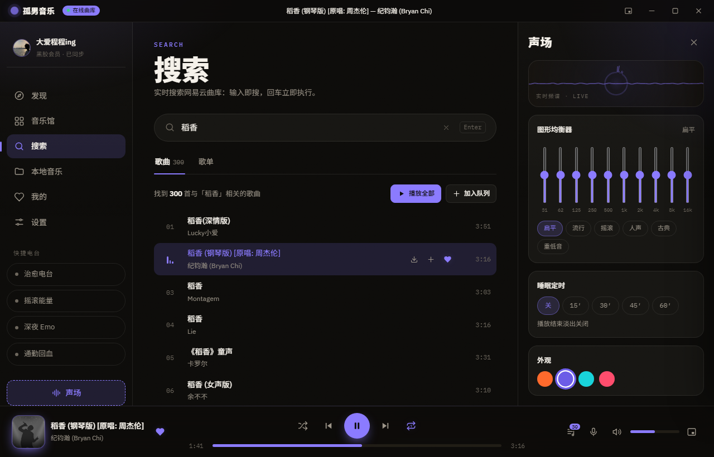
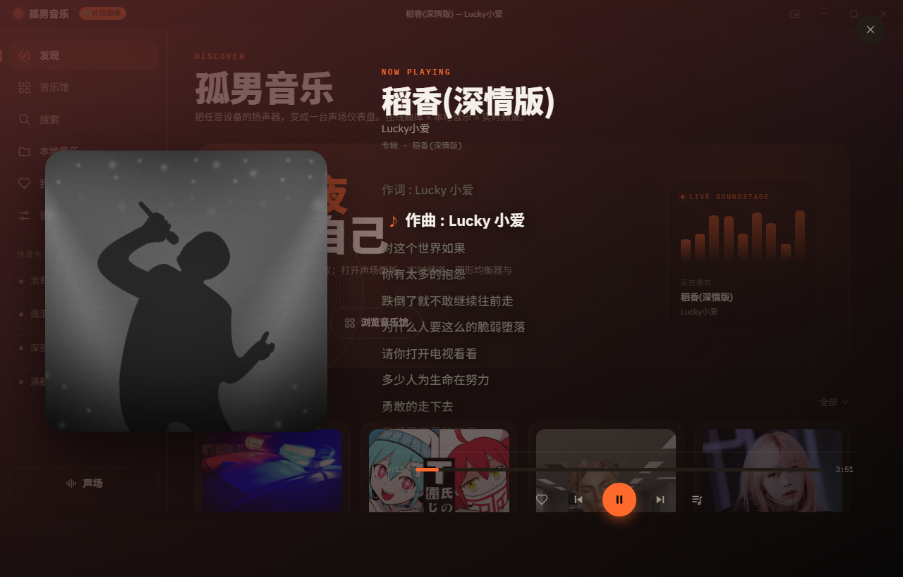
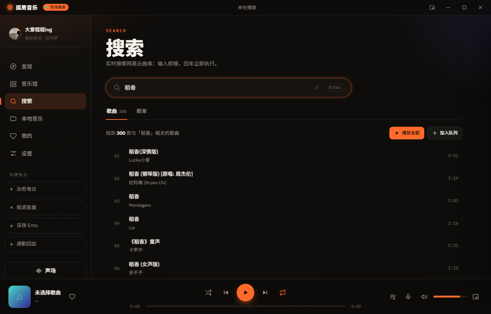
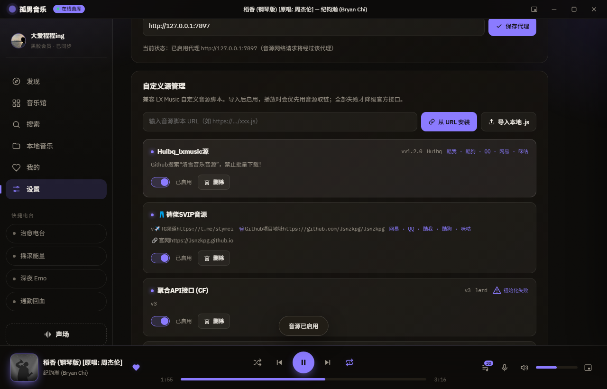
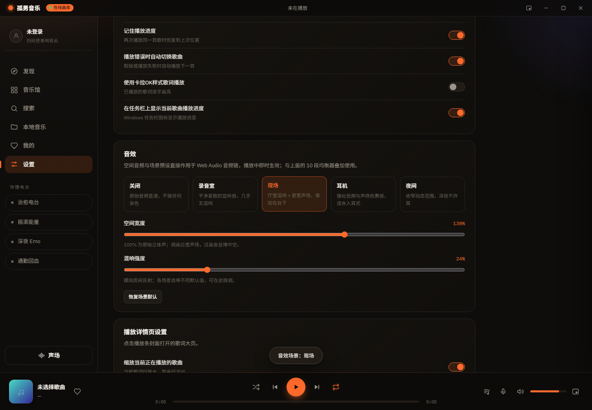
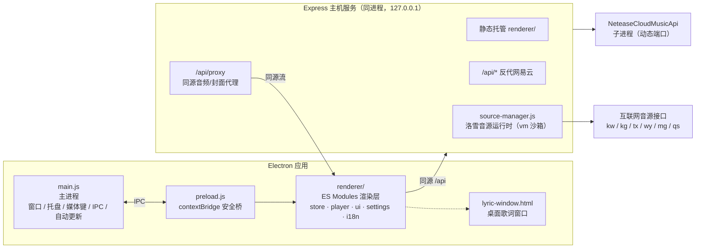

<div align="center">


# 孤男音乐 · Guman Music

**🎧 一个把「发现音乐」和「声场体验」都做足的 Electron 桌面音乐客户端**

在线网易云曲库 · 洛雪自定义音源 · 实时频谱 · 卡拉OK歌词 · 10 段均衡器 · 桌面歌词 · 本地音乐

[](https://github.com/kedamano/Lonely-Guy-Music/releases)
[](https://www.electronjs.org/)
[](#-ui-回归测试)
[](https://github.com/kedamano/Lonely-Guy-Music/releases)
[](LICENSE)
[](#-界面语言)

[English](README_EN.md) | 简体中文

**[⬇️ 下载安装包](#-快速开始)** · **[✨ 功能总览](#-功能总览)** · **[🎮 快捷键](#-全局快捷键)** · **[🧱 架构设计](#-架构设计)** · **[❓ FAQ](#-faq)**



</div>

---

## 目录

- [为什么做这个项目](#为什么做这个项目)
- [功能总览](#-功能总览)
- [快速开始](#-快速开始)
- [界面一览](#-界面一览)
- [全局快捷键](#-全局快捷键)
- [架构设计](#-架构设计)
- [洛雪音源系统](#-洛雪音源系统)
- [UI 回归测试](#-ui-回归测试)
- [路线图](#-路线图)
- [FAQ](#-faq)
- [参与贡献](#-参与贡献)
- [免责声明](#-免责声明)
- [开源许可](#-开源许可)

---

## 为什么做这个项目

市面上的桌面音乐播放器大多二选一：要么只做「曲库门户」，要么只做「本地播放」。
孤男音乐想把两边都做到位——

- **曲库侧**：类网易云的发现/音乐馆/搜索体验，配上**洛雪自定义音源系统**，导入社区音源脚本即可全线上搜歌、取链、播放；
- **声场侧**：这不是一个「能放歌就行」的播放器——**实时环形频谱、10 段图形均衡器、逐字卡拉OK歌词、桌面歌词、睡眠淡出**，全部基于 Web Audio 真实接通音频流，而不是摆设。

> 灵感来源：视觉与交互参考了 [魔力音乐](https://yy.juhuang.xyz/)，音源体系兼容 [洛雪音乐自定义源 API](https://lxmusic.toside.cn/desktop/custom-source)。在此致敬。

---

## ✨ 功能总览

### 🎵 曲库与播放

| 功能 | 说明 |
|---|---|
| 发现 / 音乐馆 / 搜索 | 精选歌单墙、分类浏览、输入即搜（300ms 防抖）+ 回车执行，切页保留关键词与结果 |
| **多平台搜索** | 一键切换 **网易云 / QQ 音乐 / 酷狗**，直接按平台检索，跳出网易云元数据；QQ 拿到 songmid、酷狗拿到 FileHash，可直接交给音源取链播放 |
| 歌单详情 | 一键播放全部 / 随机播放 / 整单加入队列 |
| 播放控制 | 播放/暂停/上一首/下一首、列表·单曲·顺序三种循环、拖拽进度与音量 |
| 播放队列 | 抽屉式管理，可增删、跳播，插入位置可选顶部/底部 |
| 收藏与历史 | 可移除/清空，跨会话持久化，每首歌记住上次播放进度 |
| **云歌单** | 登录后直接读取账号里的「我喜欢的音乐」与全部云端歌单，点击即播，不占用本机空间 |
| 分页 | 音乐馆与搜索走服务端分页（每页 30），超长歌单走客户端分页（每页 50） |

### 🔊 声场体验（桌面端专属）

| 功能 | 说明 |
|---|---|
| 🎚 实时频谱 | Web Audio `AnalyserNode` 环形频谱 + 波形，无音频时待机动画 |
| 🎛 图形均衡器 | 10 段 EQ，多套预设（流行/摇滚/人声/古典/低音增强…），真实作用于音频链路 |
| 🌌 空间音频 | M/S 矩阵立体声加宽 + 卷积混响 + 低音增强 + 动态压缩，**5 套场景预设**（关闭 / 录音室 / 现场 / 耳机 / 夜间），宽度与混响强度可微调 |
| 🎤 卡拉OK歌词 | LRC 逐行高亮 + 逐字填充 + 当前行缩放，点击任意行跳转播放 |
| 🖥 桌面歌词 | 独立无边框透明置顶窗口，三色自定义、字号/加粗/对齐可调、可鼠标穿透 |
| 💤 睡眠定时 | 到点先淡出再暂停，面板内实时倒计时 |
| 🎨 歌词页背景 | 封面模糊 / 封面主色提取 / 纯净底色三种模式，任意背景下歌词可读 |

### 🧰 桌面级能力

| 功能 | 说明 |
|---|---|
| 📂 本地音乐 | 拖入或选择文件/文件夹导入 mp3/flac 等，与在线曲库共用同一套播放器与声场 |
| ⬇️ 下载 | 曲目行与歌词页一键下载，命名规则与目录可配置 |
| 🪟 迷你模式 | 自定义标题栏 + 真实缩放置顶；系统托盘常驻 |
| ⌨️ 全局媒体键 | `MediaPlayPause` 等媒体键 + 托盘播放控制 |
| 🧭 系统媒体会话 | Windows/macOS 媒体面板显示曲目信息，任务栏图标实时显示播放进度 |
| 🔐 三种登录方式 | 扫码 / 手机号验证码 / 邮箱密码，凭证只落本机后端；登录后歌单、收藏、每日推荐全部可用 |
| 🌐 三语言界面 | 简体中文 / 繁體中文 / English，切换即时生效 |
| 🎭 4 套强调色 | 信号琥珀 / 霓虹紫 / 电子青 / 玫红，全站色彩由 CSS `color-mix` 派生，切换无死角 |
| 🪶 性能友好 | 6 档字号、4 档窗口尺寸、动画可关（低性能设备更流畅） |

### 🛡 可靠性细节

- **封面永不破图**：封面与音频同走同源代理，加载失败自动回退「渐变封面 + 音符图标」，专辑封面缺失时回退艺人图；
- **播放失败说人话**：汇总每个音源的尝试结果（`已尝试 N 个音源均失败：音源名（原因）…`），技术错误码翻译成可读文案；
- **模式徽标不撒谎**：启动即查运行模式并持续轮询，NCM 子进程冷启动再慢也不会误报「离线」；
- **播放时阻止系统休眠**；播放错误自动切下一首；启动自动续播上次歌曲与进度。

---

## 🚀 快速开始

### 方式一：下载安装包（推荐）

前往 [**Releases**](https://github.com/kedamano/Lonely-Guy-Music/releases) 下载 `GumanMusic-x.y.z-x64.exe`（Windows，NSIS 安装器）。

> 安装包未做代码签名，首次运行时 SmartScreen 可能提示——点击「更多信息 → 仍要运行」即可。

### 方式二：从源码运行

```bash
git clone https://github.com/kedamano/Lonely-Guy-Music.git
cd Lonely-Guy-Music
npm install
npm start
```

- 默认 `npm start` 拉起本地网易云 API（动态端口）并托管 UI，启动后即为**在线模式**；
- 若网易云 API 不可达，自动降级为**内置示例曲库**（离线也能完整体验所有交互）；
- 纯离线示例模式：`ENABLE_NCM=0 npm start`；
- 纯后端调试（浏览器访问 UI）：`ENABLE_NCM=0 npm run server`，打开 `http://localhost:3000`。

### 从源码打包

```bash
npm run dist        # 产出 NSIS 安装包到 dist/
npm run dist:dir    # 仅产出免安装目录
```

---

## 🖼 界面一览

| 主界面 + 声场面板 | 卡拉OK歌词（封面主色背景） |
|:---:|:---:|
|  |  |

| 实时搜索 | 洛雪自定义源管理 |
|:---:|:---:|
|  |  |

| 音效场景与空间音频 | 三种登录方式 |
|:---:|:---:|
|  |  |

---

## 🎮 全局快捷键

| 按键 | 功能 | 按键 | 功能 |
|---|---|---|---|
| <kbd>空格</kbd> | 播放 / 暂停 | <kbd>/</kbd> | 跳转并聚焦搜索 |
| <kbd>←</kbd> / <kbd>→</kbd> | 快退 / 快进 5 秒 | <kbd>L</kbd> | 打开歌词浮层 |
| <kbd>↑</kbd> / <kbd>↓</kbd> | 音量 ±5% | <kbd>M</kbd> | 迷你模式 |
| <kbd>Q</kbd> | 播放队列 | <kbd>Esc</kbd> | 关闭浮层 / 队列 / 迷你模式 |
| 媒体键 | 播放/暂停·上一首·下一首 | 托盘菜单 | 播放控制 |

---

## 🧱 架构设计



**三个关键设计决策：**

1. **单源架构，免 CORS** —— 后端同时托管 UI 与 `/api`，渲染层只访问同源接口，Electron `webSecurity` 可以保持开启；
2. **同源音频代理** —— 跨域媒体接入 Web Audio 会被静音（tainted），`/api/proxy` 把远程音频转发为同源流，均衡器与频谱才能真实生效；
3. **音源脚本沙箱** —— 音源脚本来自互联网，在 `vm.runInNewContext` 中执行：只暴露标准 JS 全局 + `lx` API，不提供 `require`/`fs`，HTTP 一律经后端转发。

<details>
<summary><b>📁 项目结构</b>（点击展开）</summary>

```
main.js               Electron 主进程：窗口/托盘/媒体键/IPC/日志兜底/自动更新
preload.js            contextBridge 安全暴露能力（contextIsolation，无 nodeIntegration）
main-log.js           日志落盘与轮转（userData/logs/guman.log，2MB 轮转）
server/
  index.js            主机后端：托管 UI + /api 反代或离线 mock + 音源 API + 同源音频代理
  mock.js             离线示例数据（与网易云响应结构一致）
  source-manager.js   洛雪音源运行时：vm 沙箱执行音源脚本、lx API 实现、URL/歌词/封面解析
  platform-search.js  多平台搜索：QQ 音乐（vkeys）/ 酷狗（官方搜索接口）适配与统一曲目结构
  account.js          账号能力
  library.js          本地曲库
  translate.js        歌词翻译
renderer/
  index.html          结构（SVG 图标系统 / 标题栏 / 侧边栏 / 主视图 / 声场面板 / 播放条 / 队列抽屉 / 歌词浮层）
  lyric-window.html   桌面歌词独立窗口（透明无边框置顶）
  styles.css          设计系统（暗夜声场主题，含响应式与迷你模式）
  assets/fonts/       自托管字体（@fontsource 子集，113 个 woff2，无外网依赖）
  js/
    store.js          状态与持久化（设置/收藏/历史/本地库/队列/播放进度）
    api.js            API 客户端（超时、曲目归一化、音源可用性缓存）
    i18n.js           三语言运行时（字典 + 模板 + 动态句正则匹配）
    lyrics.js         LRC 解析与逐行定位（含卡拉OK逐字时长）
    visualizer.js     实时频谱（环形频谱 + 波形，含待机动画）
    player.js         播放引擎（Web Audio：队列/EQ/分析/睡眠淡出/音源取链/媒体会话）
    ui.js             DOM/图标/封面/空态/列表/分页器组件
    settings.js       设置页（10 个分区）
    app.js            编排层：路由/视图/搜索/队列/播放控制/快捷键/设置分发
assets/icon.js        自包含图标生成（zlib 编码 PNG/ICO，无需二进制资源）
scripts/
  build-fonts.js      字体子集构建
  ui-check.js         Playwright UI 回归（29 项 + 截图）
  ui-smoke.js         全量按钮冒烟（65 项）
  proxy-check.js      代理机制单测（12 项）
```

</details>

---

## 🎼 洛雪音源系统

完整兼容 [LX Music 自定义源脚本](https://lxmusic.toside.cn/desktop/custom-source)（`globalThis.lx` 事件模型：`inited` / `request` / `updateAlert`）：

- **沙箱执行**：音源脚本运行在 Node `vm` 沙箱，提供 `lx.request`（HTTP 全功能：headers/body/form/formData/timeout/重定向）与 `lx.utils`（buffer/crypto/zlib）；
- **全平台支持**：酷我(kw) / 酷狗(kg) / QQ(tx) / 网易(wy) / 咪咕(mg) / 汽水(qs)；
- **音质回退**：默认音质可选 FLAC 24bit / FLAC / 320K / 192K / 128K，取不到自动向下回退；
- **多源容错**：按启用顺序逐个尝试取链，失败自动跳到下一个；全部失败才降级网易云官方接口，并在 toast 中汇总每个音源的失败原因；
- **来源管理**：设置 → 自定义源管理，支持导入本地 `.js` / 从 URL 安装 / 启用禁用 / 删除；
- **网络代理可控**：音源请求**默认直连，不读取系统代理环境变量**（避免本机失效代理拖垮全部音源）；需要时在「设置 → 网络代理」填写，保存即生效。

<details>
<summary><b>🔌 音源 HTTP API</b>（供二次开发，点击展开）</summary>

| 方法 | 说明 |
|---|---|
| `GET /api/sources` | 音源列表 + 配置 |
| `POST /api/sources/load` | 载入音源 `{ path?, url?, code? }` |
| `POST /api/sources/toggle` | 启用/禁用 `{ id, enabled }` |
| `POST /api/sources/remove` | 删除音源 `{ id }` |
| `POST /api/sources/quality` | 设置默认音质 `{ quality }` |
| `POST /api/sources/proxy` | 设置网络代理 `{ proxy }`，留空 = 恢复直连 |
| `POST /api/sources/resolve` | 取播放链 `{ sourcePlatform, musicInfo, quality?, sourceId? }` |
| `POST /api/sources/action` | 通用动作 `{ action: 'musicUrl'/'lyric'/'pic', ... }` |

</details>

---

## 🧪 UI 回归测试

基于 Playwright 的真实交互回归（共 **160 项断言**）：

```bash
npm start                        # 或 ENABLE_NCM=0 node server/index.js
node scripts/ui-check.js         # 65 项交互检查 + 截图
node scripts/ui-smoke.js         # 64 项全量冒烟（封面加载/分页/设置/语言切换…）
node scripts/proxy-check.js      # 12 项代理机制单测
node scripts/search-guide-check.js # 19 项搜索引导与多语言检查
```

覆盖范围：实时搜索 / 切 tab / 播放 / 拖拽进度 / 收藏 / 队列 / 歌词浮层 / 声场 EQ 与睡眠 / 本地音频导入播放 / 迷你模式 / 响应式布局 / 全部设置分区 / 封面真实加载断言 / 运行时 console 错误检查。截图输出到 `scripts/shots/`。

---

## 🗺 路线图

- [x] **多平台搜索**：已支持网易云 / QQ 音乐 / 酷狗，直接按平台检索
- [x] **歌单云同步 / 账号登录**：扫码 + 手机验证码 + 邮箱密码，云歌单直接播放
- [x] **macOS / Linux 安装包**：dmg / zip / AppImage / deb，由 GitHub Actions 三平台矩阵构建
- [x] **音效链扩展**：空间音频（M/S 加宽 + 卷积混响 + 压缩）与 5 套场景预设
- [ ] 咪咕 / 汽水搜索源接入
- [ ] 歌单双向编辑（在客户端内增删云端歌单）

已支持 ✅：应用内自动更新（`electron-updater` + GitHub Releases 源，发布新版本后启动即提示）

---

## ❓ FAQ

<details>
<summary><b>为什么有的歌放不出来？</b></summary>

网易云部分 VIP 曲目 `/song/url` 返回空地址；导入音源后绝大多数歌曲可经音源取链播放。全部音源失败时会提示每个音源的原因。
</details>

<details>
<summary><b>音源失效了怎么办？</b></summary>

音源上游由第三方维护，可能失效。应用会自动跳过失败音源尝试下一个；你也可以在「设置 → 自定义源管理」停用失效源、换用新源。
</details>

<details>
<summary><b>为什么装完打不开 / SmartScreen 拦截？</b></summary>

安装包未做代码签名。SmartScreen 提示时点击「更多信息 → 仍要运行」即可。
</details>

<details>
<summary><b>需要代理吗？</b></summary>

默认直连，且**不读取系统代理环境变量**（防止本机失效代理拖垮音源加载）。如果你的网络必须经代理访问音源接口，在「设置 → 网络代理」填写即可，保存即生效。
</details>

<details>
<summary><b>本地音乐重启后还在吗？</b></summary>

收藏、播放历史、搜索历史、设置均跨会话持久化；本地音乐导入目前为会话级（浏览器 objectURL 限制），重启后需重新导入。
</details>

---

## 🤝 参与贡献

欢迎 Issue 与 PR：

1. Fork → 新建分支（`feat/xxx`）→ 提交；
2. UI 改动请附 `node scripts/ui-smoke.js` 通过的说明或截图；
3. 涉及音源的改动请勿提交任何音源脚本本身（见下方免责声明）。

---

## ⚠️ 免责声明

- 本项目的**在线曲库能力依赖第三方非官方网易云接口**，仅供学习研究；请遵守相关平台服务条款，勿用于商业或侵权用途；
- 本项目**不分发、不内置任何音源脚本**；音源由用户自行导入，其可用性与内容由第三方维护，与本项目无关；
- 音乐版权归原作者所有，请支持正版。

## 📄 开源许可

[MIT](LICENSE) © 孤男音乐

字体资源（Anton / IBM Plex Sans / IBM Plex Mono / Noto Sans SC）经 [@fontsource](https://fontsource.org/) 自托管，遵循各自的开源许可，详见 [NOTICE.txt](renderer/assets/fonts/NOTICE.txt)。

<div align="center">

**如果这个项目对你有帮助，欢迎点一个 ⭐ Star**

</div>
