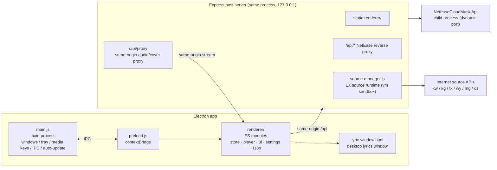

<div align="center">


# Guman Music · 孤男音乐

**🎧 An Electron desktop music client that takes both music discovery and soundstage experience seriously**

NetEase online library · LX Music custom sources · Live spectrum · Karaoke lyrics · 10-band EQ · Desktop lyrics · Local music

[](https://github.com/kedamano/Lonely-Guy-Music/releases)
[](https://www.electronjs.org/)
[](#-ui-regression-tests)
[](https://github.com/kedamano/Lonely-Guy-Music/releases)
[](LICENSE)

English | [简体中文](README.md)

**[⬇️ Download](#-get-started)** · **[✨ Features](#-features)** · **[🎮 Shortcuts](#-global-shortcuts)** · **[🧱 Architecture](#-architecture)**


</div>

---

## Why this project

Most desktop music players force a choice: either a "library portal" or a "local player".
Guman Music aims to do both well —

- **Library side**: a NetEase-Cloud-Music-like discover / explore / search experience, plus a **LX Music custom-source system** — import community source scripts and search, resolve URLs, and play across the web;
- **Soundstage side**: this is not a "just play the file" player — **live circular spectrum, 10-band graphic EQ, word-by-word karaoke lyrics, desktop lyrics, sleep fade-out**, all wired into the real Web Audio graph instead of being decoration.

> Inspiration: UI/UX references [Moli Music](https://yy.juhuang.xyz/); the source system is compatible with the [LX Music custom source API](https://lxmusic.toside.cn/desktop/custom-source). All credits to them.

---

## ✨ Features

### 🎵 Library & Playback

| Feature | Description |
|---|---|
| Discover / Explore / Search | Playlist walls, category browsing, type-to-search (300ms debounce) + Enter, keywords preserved across tabs |
| Playlist detail | Play all / shuffle / queue the whole playlist |
| Playback controls | Play/pause/prev/next, list·single·sequential loop, draggable progress & volume |
| Play queue | Drawer management: add, remove, jump; insert at top or bottom |
| Favorites & history | Removable/clearable, persisted across sessions, per-song resume position |
| Pagination | Server-side (30/page) for explore & search, client-side (50/page) for long playlists |

### 🔊 Soundstage (desktop-exclusive)

| Feature | Description |
|---|---|
| 🎚 Live spectrum | Web Audio `AnalyserNode` circular spectrum + waveform, with idle animation |
| 🎛 Graphic EQ | 10-band EQ with presets (pop/rock/vocal/classical/bass boost…), applied to the real audio graph |
| 🎤 Karaoke lyrics | LRC line highlight + word-by-word fill + current-line scaling, click any line to seek |
| 🖥 Desktop lyrics | Frameless transparent always-on-top window, 3-color customization, font size/weight/alignment, click-through lock |
| 💤 Sleep timer | Fade-out then pause, live countdown in the panel |
| 🎨 Lyrics background | Cover blur / cover dominant color / plain background — lyrics stay readable in all modes |

### 🧰 Desktop-grade capabilities

| Feature | Description |
|---|---|
| 📂 Local music | Drag in files/folders (mp3/flac…), same player and soundstage as the online library |
| ⬇️ Download | One-click download from track rows and lyrics page; naming rules and directory configurable |
| 🪟 Mini mode | Custom title bar + real resizable always-on-top window; system tray |
| ⌨️ Global media keys | `MediaPlayPause` etc. + tray playback controls |
| 🧭 OS media session | Windows/macOS media panel shows track info; taskbar icon shows live progress |
| 🌐 Trilingual UI | 简体中文 / 繁體中文 / English, instant switch |
| 🎭 4 accent colors | Signal Amber / Neon Purple / Electric Cyan / Rose — all colors derived via CSS `color-mix` |
| 🪶 Performance friendly | 6 font sizes, 4 window sizes, animations can be disabled |

### 🛡 Reliability details

- **Covers never break**: covers and audio go through the same-origin proxy; on failure it falls back to a generated gradient cover + note icon, and to artist image when album art is missing;
- **Human-readable failures**: failed URL resolution summarizes every source attempt; technical error codes are translated into plain language;
- **Honest mode badge**: runtime mode is polled continuously — a slow NCM cold start never leaves a stale "offline" badge;
- Playback blocks system sleep; playback errors auto-skip to the next track; startup auto-resumes the last song and position.

---

## 🚀 Get Started

### Option 1: Download the installer (recommended)

Grab the build for your platform from [**Releases**](https://github.com/kedamano/Lonely-Guy-Music/releases):

| Platform | File | Notes |
|---|---|---|
| Windows x64 | `GumanMusic-x.y.z-x64.exe` | NSIS installer |
| macOS Intel | `GumanMusic-x.y.z-x64.dmg` | Use `-arm64.dmg` on Apple Silicon |
| Linux x64 | `GumanMusic-x.y.z-x86_64.AppImage` | `chmod +x` and run |
| Debian / Ubuntu | `GumanMusic-x.y.z-amd64.deb` | `sudo dpkg -i` |

> Builds are not code-signed: on Windows SmartScreen shows a warning ("More info → Run anyway"); on macOS allow the app in System Settings → Privacy & Security.

### Option 2: Run from source

```bash
git clone https://github.com/kedamano/Lonely-Guy-Music.git
cd Lonely-Guy-Music
npm install
npm start
```

- `npm start` boots a local NetEase API (dynamic port) and serves the UI — online mode by default;
- If the NetEase API is unreachable, it falls back to a built-in demo library (full interactivity offline);
- Offline demo only: `ENABLE_NCM=0 npm start`;
- Backend-only debugging: `ENABLE_NCM=0 npm run server`, then open `http://localhost:3000`.

### Build from source

```bash
npm run dist        # NSIS installer into dist/
npm run dist:dir    # unpacked directory only
```

---

## 🖼 Screenshots

| Main window + soundstage panel | Karaoke lyrics (cover color background) |
|:---:|:---:|
|  |  |

| Live search | LX custom source management |
|:---:|:---:|
|  |  |

---

## 🎮 Global Shortcuts

| Key | Action | Key | Action |
|---|---|---|---|
| <kbd>Space</kbd> | Play / pause | <kbd>/</kbd> | Jump to search |
| <kbd>←</kbd> / <kbd>→</kbd> | Seek ±5s | <kbd>L</kbd> | Lyrics overlay |
| <kbd>↑</kbd> / <kbd>↓</kbd> | Volume ±5% | <kbd>M</kbd> | Mini mode |
| <kbd>Q</kbd> | Play queue | <kbd>Esc</kbd> | Close overlay / queue / mini mode |
| Media keys | play/pause · prev · next | Tray menu | Playback controls |

---

## 🧱 Architecture



**Three key design decisions:**

1. **Single-origin architecture, no CORS** — the backend serves both the UI and `/api`; the renderer only talks to same-origin endpoints, so Electron `webSecurity` stays on;
2. **Same-origin audio proxy** — cross-origin media is muted (tainted) once routed into Web Audio; `/api/proxy` re-serves remote audio as a same-origin stream so EQ and spectrum actually work;
3. **Sandboxed source scripts** — third-party source scripts run in `vm.runInNewContext` with only standard JS globals + the `lx` API; no `require`/`fs`, and all HTTP goes through the backend.

<details>
<summary><b>📁 Project layout</b> (click to expand)</summary>

```
main.js               Electron main process: windows/tray/media keys/IPC/log fallback/auto-update
preload.js            contextBridge secure exposure (contextIsolation, no nodeIntegration)
main-log.js           Log persistence & rotation (userData/logs/guman.log, 2MB)
server/
  index.js            Host server: UI + /api reverse proxy or offline mock + source API + audio proxy
  mock.js             Offline demo data (NetEase-compatible response shapes)
  source-manager.js   LX source runtime: vm sandbox, lx API, URL/lyric/cover resolution
  account.js          Account features
  library.js          Local library
  translate.js        Lyric translation
renderer/
  index.html          Structure (SVG icon system / title bar / sidebar / views / soundstage / playbar / queue / lyrics)
  lyric-window.html   Desktop lyrics window (frameless transparent always-on-top)
  styles.css          Design system (Midnight Soundstage theme, responsive + mini mode)
  assets/fonts/       Self-hosted fonts (@fontsource subsets, 113 woff2 files, zero external requests)
  js/
    store.js          State & persistence
    api.js            API client (timeout, track normalization, source availability cache)
    i18n.js           Trilingual runtime (dictionary + templates + dynamic sentence matching)
    lyrics.js         LRC parsing & line timing (karaoke word durations)
    visualizer.js     Live spectrum (circular + waveform, idle animation)
    player.js         Playback engine (Web Audio: queue/EQ/analyzer/sleep fade/source resolution/media session)
    ui.js             DOM/icons/covers/empty states/lists/paginator
    settings.js       Settings page (10 sections)
    app.js            Orchestration: routing/views/search/queue/playback/shortcuts/settings dispatch
assets/icon.js        Self-contained icon generation (zlib-encoded PNG/ICO, no binary assets)
scripts/
  build-fonts.js      Font subset build
  ui-check.js         Playwright UI regression (29 checks + screenshots)
  ui-smoke.js         Full smoke test (65 checks)
  proxy-check.js      Proxy mechanism unit tests (12 checks)
```

</details>

---

## 🎼 LX Source System

Fully compatible with [LX Music custom source scripts](https://lxmusic.toside.cn/desktop/custom-source) (`globalThis.lx` event model: `inited` / `request` / `updateAlert`):

- **Sandboxed execution**: scripts run in a Node `vm` sandbox with `lx.request` (full HTTP: headers/body/form/formData/timeout/redirects) and `lx.utils` (buffer/crypto/zlib);
- **All platforms**: Kuwo(kw) / Kugou(kg) / QQ(tx) / NetEase(wy) / Migu(mg) / Qishui(qs);
- **Quality fallback**: FLAC 24bit / FLAC / 320K / 192K / 128K with automatic downward fallback;
- **Multi-source fault tolerance**: sources are tried in order; failures are skipped; only when all fail does it fall back to the official NetEase endpoint — with a per-source failure summary in the toast;
- **Source management**: Settings → Custom Sources: import local `.js`, install from URL, enable/disable, delete;
- **Explicit proxy control**: source requests are **direct by default and never read system proxy env vars** (a broken local proxy can't break every source); set one in Settings → Network Proxy when needed, effective immediately.

<details>
<summary><b>🔌 Source HTTP API</b> (for secondary development, click to expand)</summary>

| Method | Description |
|---|---|
| `GET /api/sources` | List sources + config |
| `POST /api/sources/load` | Load a source `{ path?, url?, code? }` |
| `POST /api/sources/toggle` | Enable/disable `{ id, enabled }` |
| `POST /api/sources/remove` | Remove `{ id }` |
| `POST /api/sources/quality` | Set default quality `{ quality }` |
| `POST /api/sources/proxy` | Set network proxy `{ proxy }`, empty = direct |
| `POST /api/sources/resolve` | Resolve play URL `{ sourcePlatform, musicInfo, quality?, sourceId? }` |
| `POST /api/sources/action` | Generic action `{ action: 'musicUrl'/'lyric'/'pic', ... }` |

</details>

---

## 🔗 Multi-Platform Track Resolution

QQ / Kugou tracks never touch the NetEase API, and they do not hard-depend on source scripts either — resolution degrades through three layers:

| Order | Layer | Notes |
|---|---|---|
| 1 | LX source script | Used first when the user has one enabled; can deliver FLAC / 320K |
| 2 | Platform native | Kugou's mobile `playInfo` endpoint returns a full direct link anonymously (no login, no signature) |
| 3 | Cross-platform fallback | QQ's `vkey` is bound to `uin`, so anonymous requests return nothing — search Kugou by title / artist / duration and play the same track |

When a fallback or an alternate recording is used, the UI says so explicitly; tracks are never swapped silently.

**Why QQ can't be reverse-proxied like NetEase**: NetEase's URL endpoint hands out 128K even when anonymous, and returns a stateless, server-signed CDN link. QQ's `vkey` is bound to `uin + guid`, and anonymous calls return an empty `purl` (observed `104003` / `1000`) — a login state is mandatory. Kugou's `play/songinfo` requires a `signature` whose salt changes with each web release, but its mobile `playInfo` endpoint works anonymously. That asymmetry is why native resolution is enabled only for Kugou by default.

**Known limitations**:

- Free catalogue entries are mostly 128K; VIP tracks (e.g. Jay Chou originals) usually resolve only to covers or other recordings.
- There is no QQ login UI. To get QQ originals, write `{ "tx": { "uin": "your-qq-id", "qmKeyst": "qm_keyst from cookie" } }` into `userData/platform-auth.json` and resolution will prefer the official QQ vkey.

---

## 🧪 UI Regression Tests

Playwright-based real-interaction regression (**184 assertions** total):

```bash
npm start                        # or ENABLE_NCM=0 node server/index.js
node scripts/ui-check.js         # 65 interaction checks + screenshots
node scripts/ui-smoke.js         # 64 full smoke checks (covers/pagination/settings/i18n…)
node scripts/proxy-check.js      # 12 proxy mechanism unit tests
node scripts/search-guide-check.js # 19 search-guide & i18n checks
node scripts/platform-url-check.js # 14 platform resolution (scoring + Kugou link + QQ fallback)
node scripts/version-check.js     # 5 version-string contract checks
npx electron scripts/tray-check.js # 5 tray icon checks (ICO empty-image regression + real bounds)
```

Covers: live search / tab switching / playback / seek dragging / favorites / queue / lyrics overlay / soundstage EQ & sleep / local audio import & playback / mini mode / responsive layout / every settings section / real cover-load assertions / runtime console error checks. Screenshots go to `scripts/shots/`.

---

## 🗺 Roadmap

- [x] **Multi-platform search**: NetEase / QQ Music / Kugou, queried directly per platform
- [x] **Cloud playlist sync / account login**: QR code + phone captcha + email password; cloud playlists play directly
- [x] **macOS / Linux installers**: dmg / zip / AppImage / deb, built by a three-platform GitHub Actions matrix
- [x] **Audio chain extensions**: spatial audio (M/S widening + convolution reverb + compression) and 5 scene presets
- [x] **Auto-update loop**: `electron-updater` against the GitHub Releases feed — new versions prompt on launch
- [ ] Migu / Qishui search sources
- [ ] Two-way playlist editing (add/remove cloud playlists in-app)

---

## ❓ FAQ

<details>
<summary><b>Why won't some songs play?</b></summary>

Some NetEase VIP tracks return an empty URL. With a source imported, most songs resolve through it. When every source fails, a per-source reason summary is shown.
</details>

<details>
<summary><b>A source stopped working — what now?</b></summary>

Upstream sources are maintained by third parties and can go offline. The app skips failing sources automatically; you can disable a dead source or import a new one in Settings → Custom Sources.
</details>

<details>
<summary><b>SmartScreen blocks the installer?</b></summary>

The installer is not code-signed yet. Click "More info → Run anyway".
</details>

<details>
<summary><b>Do I need a proxy?</b></summary>

Direct by default — system proxy env vars are intentionally ignored (a broken local proxy must not break source loading). If your network requires a proxy for source APIs, set it in Settings → Network Proxy; it takes effect immediately.
</details>

<details>
<summary><b>Does local music survive restarts?</b></summary>

Favorites, history, search history and settings persist across sessions. Local music imports are session-scoped (browser objectURL limitation) and need re-import after restart.
</details>

---

## 🤝 Contributing

Issues and PRs are welcome:

1. Fork → branch (`feat/xxx`) → commit;
2. For UI changes, attach a passing `node scripts/ui-smoke.js` run or screenshots;
3. Do not submit any source scripts themselves (see the disclaimer below).

---

## ⚠️ Disclaimer

- The online library relies on **third-party unofficial NetEase interfaces**, for learning and research only; comply with the platforms' terms of service — no commercial or infringing use;
- This project **does not ship or bundle any source script**; sources are imported by users and maintained by third parties, unrelated to this project;
- All music copyrights belong to their owners — please support official releases.

## 📄 License

[MIT](LICENSE) © Guman Music

Fonts (Anton / IBM Plex Sans / IBM Plex Mono / Noto Sans SC) are self-hosted via [@fontsource](https://fontsource.org/) under their respective licenses — see [NOTICE.txt](renderer/assets/fonts/NOTICE.txt).

<div align="center">

**If this project helps you, consider giving it a ⭐ Star**

</div>
